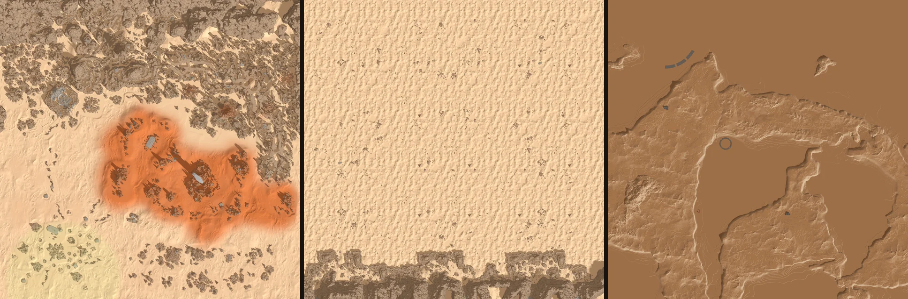

# Dune: Awakening Map

Interactive map of Dune: Awakening built from the game files, covering the Hagga Basin, all twelve Deep Desert layouts and the Overland.

Places carry the game's own icons and names. Resource spots show what can spawn there and how likely it is, Titanium and Stravidium included. Crashed ships and spice fields show their spawn sites and rules. The Hagga Basin and the Deep Desert have a 3D view with the game's rocks, buildings and wrecks. Search finds places, resources, grid references and coordinates, and a tracker counts the 10,000 of each resource for the harvesting achievement.

- Windows: download [Dune-Awakening-Map-windows.zip](https://github.com/AdrianDittmann/dune-awakening-map/releases/latest/download/Dune-Awakening-Map-windows.zip), extract it and run `Dune Awakening Map.exe`. The map opens in the default browser, and the program stops 10 minutes after the tab is closed. It is not code-signed: if SmartScreen stops it, choose More info, then Run anyway.
- Other systems: serve the zip's `app` folder with any static web server, for example `python3 -m http.server 47816 --bind 127.0.0.1 --directory app`, and open `http://127.0.0.1:47816`.
- The app runs in the browser and does not touch the game. The Deep Desert layout of the current week is marked from [`live.json`](live.json), which holds its number (0-11, shown as 1-12) and the time it went live.

## Build

Requires Node.js 20 or later, pnpm and Rust. The map data is generated from the game files and is not in the repository: copy `app/data` and `app/tiles` from the release zip into `app/public/`, then run `pnpm install` and `pnpm dev` in `app`. On Windows, `scripts/package.ps1` builds the web app and the launcher into `release/Dune-Awakening-Map-windows.zip`.

## Legal

Unofficial fan project, not affiliated with or endorsed by Funcom or Legendary. Dune and Dune: Awakening are registered trademarks of Legendary. The game content shown on the map belongs to its owners. The code is released under the MIT License.
